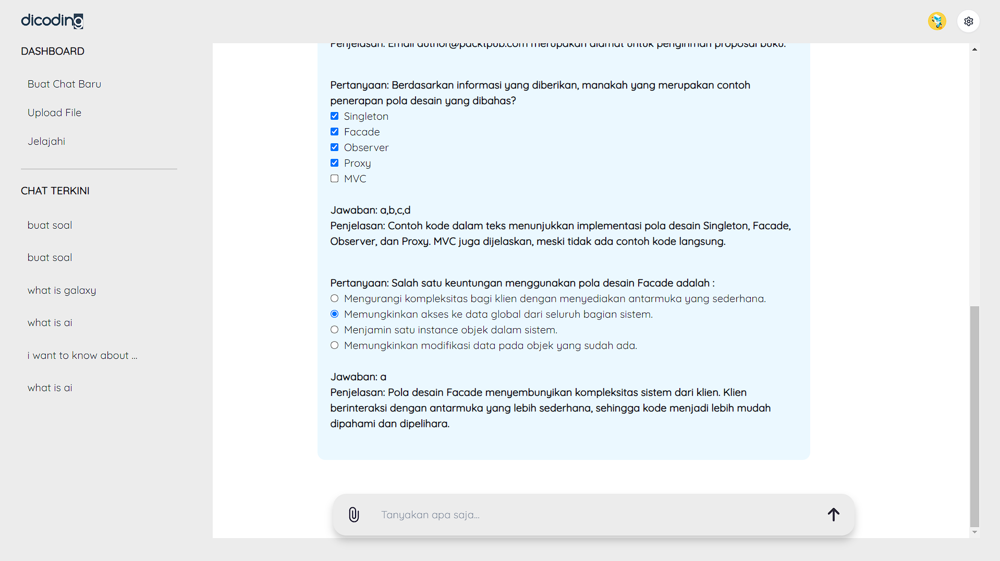

# Dicoding Generative AI Web Application

## Executive Summary


Indonesia’s educational technology sector faces significant challenges in leveraging Generative AI, particularly with Large Language Models (LLMs) like Google's Gemini for Bahasa Indonesia on Google Cloud. This project addresses these challenges by building a Generative AI system tailored for Dicoding, enabling automated, curriculum-aligned content generation and improving contextual accuracy in forums and chats.

Our solution integrates LLM with a MERN (MongoDB, Express, React, Node.js) web application, streamlining content creation, enhancing accessibility, and boosting learner engagement. By automating manual processes, this system establishes a scalable foundation for advancing AI-driven education in Indonesia.

---

## Features



- **Content Generation**: Automates the creation of curriculum-aligned content, reducing manual workload.
- **Improved Bahasa Indonesia Accuracy**: Fine-tuned responses for forums and chat support.
- **Dynamic Assessments**: Generates quizzes and assessments with varying complexity.
- **Custom Gemini Avatar**: Personalized bot avatar for enhanced user experience.
- **Seamless Integration**: Built on MERN architecture with Gemini LLM integration for Google Cloud.

---

### RAG (Retrieval-Augmented Generation) Features

- **File Upload**: Users can upload documents for RAG processing.
- **File Download**: Generated outputs can be downloaded as documents.
- **File Deletion**: Uploaded files can be deleted after use.

---

## Tech Stack

- **Frontend**: React.js with Vite
- **Backend**: Python FastAPI (unified backend)
- **Database**: MongoDB (Motor async driver)
- **RAG System**: [Kotaemon](https://github.com/Cinnamon/kotaemon) - Open-source RAG UI
- **AI Agent**: Pydantic AI for question generation
- **Authentication**: Clerk
- **Hosting (optional)**: Google Cloud Platform (GCP)

---

## Installation

### Prerequisites

1. Node.js (v18+) and npm installed
2. Python 3.10+ installed
3. MongoDB instance running locally or on a cloud server
4. Docker (recommended for running Kotaemon)
5. Optional: Google Cloud Platform (GCP)

### Setup Instructions

#### Frontend

1. Navigate to the frontend directory:
   ```bash
   cd client
   ```
2. Install dependencies:
   ```bash
   npm install
   ```
3. Start the development server:
   ```bash
   npm run dev
   ```

#### Backend

1. Navigate to the backend directory:
   ```bash
   cd backend
   ```
2. Create and activate virtual environment:
   ```bash
   python -m venv .venv
   .venv\Scripts\activate  # Windows
   # source .venv/bin/activate  # Linux/Mac
   ```
3. Install dependencies:
   ```bash
   pip install -r requirements.txt
   ```
4. Start the server:
   ```bash
   python main.py
   ```

---

## Environment Variables

### Frontend `.env` Example
```env
VITE_CLERK_PUBLISHABLE_KEY=your_clerk_publishable_key
VITE_IMAGE_KIT_ENDPOINT=your_imagekit_endpoint
VITE_IMAGE_KIT_PUBLIC_KEY=your_imagekit_public_key
VITE_API_URL=http://localhost:8000

# API endpoints (all on unified backend port 8000)
VITE_POST_URL_AGENT=http://localhost:8000/api/kotaemon/chat
VITE_PROXY_URL=http://localhost:8000
VITE_POST_URL_UPLOAD=http://localhost:8000/api/kotaemon/upload
VITE_POST_URL_DELETE_VECTOR=http://localhost:8000/api/kotaemon/delete
VITE_UPLOAD_DIR=C:/path/to/shared/documents/
```

### Backend `.env` Example
```env
# Server
HOST=0.0.0.0
PORT=8000

# Kotaemon RAG
KOTAEMON_URL=http://localhost:7860

# MongoDB
MONGO=mongodb://localhost:27017/aichat
DATABASE_NAME=aichat

# Clerk Authentication
CLERK_PUBLISHABLE_KEY=your_clerk_publishable_key
CLERK_SECRET_KEY=your_clerk_secret_key

# AI Agent
GOOGLE_API_KEY=your_google_api_key

# File Upload
UPLOAD_DIR=C:/path/to/shared/documents/
```

---

## Usage

### Generating Content

1. Navigate to the web application.
2. Input prompts in Bahasa Indonesia for curriculum-aligned content or assessments.
3. View the generated output, fine-tuned for Dicoding's needs.

### Chat and Forum Support

- Use the chat/forum feature to ask questions. The system provides contextually accurate responses in Bahasa Indonesia.

### Document Upload, Download, and Delete (for RAG)

1. **Upload Document**:

- Users can upload documents to the system. The uploaded file will be indexed by Kotaemon for RAG processing.
- Example: Upload a document to generate content based on its content.

2. **Download Document**:

- Once the document is processed, users can download the generated output or processed file.
- Example: A PDF or Word document containing the generated content.

3. **Delete Document**:

- Users can delete the uploaded document after processing.
- Example: Files that are no longer needed can be deleted to save storage space.

---

## How It Works

1. **Frontend**: React handles user input and communicates with the backend via API calls.
2. **Unified Backend**: FastAPI (Python) processes all requests:
   - MongoDB operations for chats and documents
   - Clerk JWT authentication
   - Kotaemon RAG integration via gradio_client
   - AI Agent for question generation (Pydantic AI)
3. **Kotaemon Integration**:
   - Chat requests are sent to Kotaemon for RAG processing
   - Kotaemon retrieves relevant documents from its vector store
   - Documents are indexed into Kotaemon's vector store for RAG capabilities

---

## Deployment

1. Deploy the frontend using services like Vercel or Netlify.
2. Deploy the unified Python backend on a cloud hosting platform (e.g., Google Cloud Run, Railway, or Heroku).
3. Ensure `.env` files are securely managed and credentials are not exposed.
4. Set up Kotaemon in a Docker container:
   ```bash
   docker run -e GRADIO_SERVER_NAME=0.0.0.0 -e GRADIO_SERVER_PORT=7860 \
     -v ./ktem_app_data:/app/ktem_app_data -p 7860:7860 -it --rm \
     ghcr.io/cinnamon/kotaemon:main-full
   ```

---

## Testing

### Verify Document Selection Fix

Run the automated test suite to verify that document selection works correctly:

```bash
# Install test dependencies (if not already installed)
pip install requests

# Run test
python test_document_selection.py
```

**Test Coverage:**
- ✅ Backend connectivity
- ✅ Kotaemon connectivity  
- ✅ Document listing from Kotaemon database
- ✅ Chat without document selection
- ✅ Chat with single document selection (MAIN FIX)
- ✅ Chat with multiple document selection

**Expected Output:**
```
✅ Backend is running at http://localhost:8000
✅ Kotaemon is running at http://localhost:7860
✅ Found 3 documents
✅ Chat without documents successful
✅ Received response from backend
✅ Response includes sources/citations (RAG working!)
🎉 ALL TESTS PASSED!
```

### Manual Testing

1. **Start all services:**
   ```powershell
   .\start-dev.ps1
   ```

2. **Upload a document via Kotaemon UI:**
   - Open http://localhost:7860
   - Click "Upload" and select a PDF
   - Wait for indexing (check "Files" tab)

3. **Test document selection:**
   - Open frontend: http://localhost:5173
   - Create new chat
   - Click document selector (📎 icon)
   - Select your uploaded document
   - Ask: "Buatkan ringkasan dokumen ini"

4. **Verify logs:**
   ```powershell
   # Backend should log:
   Get-Content logs/backend_*.log -Tail 20
   
   # Look for:
   # ✅ "Loaded files for LightRAG: ['filename.pdf']"
   # ✅ "Querying with file selection mode: select"
   ```

---

## Troubleshooting

Mengalami masalah? Lihat panduan lengkap di **[docs/TROUBLESHOOTING.md](./docs/TROUBLESHOOTING.md)**

**Common Issues:**
- ✅ **FIXED**: "Skip retrieval because of no selected files" - Dokumen sekarang dipilih dengan benar
- API Key tidak valid → Configure di Kotaemon UI Settings
- Quota exceeded → Tunggu atau upgrade ke paid plan
- MongoDB connection error → Start MongoDB service
- Kotaemon tidak terhubung → Pastikan Docker running di port 7860

---

## Documentation

- **[UI Updates](./docs/UI_UPDATES.md)** - Custom avatar implementation and UI changes
- **[Troubleshooting Guide](./docs/TROUBLESHOOTING.md)** - Common issues and solutions
- **[Architecture Fix](./docs/ARCHITECTURE_FIX.md)** - System architecture documentation
- **[Changelog v2.0](./docs/CHANGELOG_v2.0.md)** - Version 2.0 changes

---

## Contribution Guidelines

We welcome contributions! To contribute:

1. Fork the repository.
2. Create a new feature branch:
   ```bash
   git checkout -b feature-name
   ```
3. Commit your changes:
   ```bash
   git commit -m "Add feature description"
   ```
4. Push to your branch:
   ```bash
   git push origin feature-name
   ```
5. Open a pull request.

---

## Acknowledgements

- [Kotaemon](https://github.com/Cinnamon/kotaemon) - Open-source RAG UI
- [Pydantic AI](https://ai.pydantic.dev/) - AI Agent framework
- [Gradio](https://www.gradio.app/)
- [FastAPI](https://fastapi.tiangolo.com/)
- [React](https://react.dev/)
- [Vite](https://vitejs.dev/)
- [Motor](https://motor.readthedocs.io/) - Async MongoDB driver
- [MongoDB](https://www.mongodb.com/)
- [Clerk](https://clerk.com/)
- [ImageKit](https://imagekit.io/)
- [Google Cloud Platform](https://cloud.google.com/)
- [Dicoding](https://www.dicoding.com)
